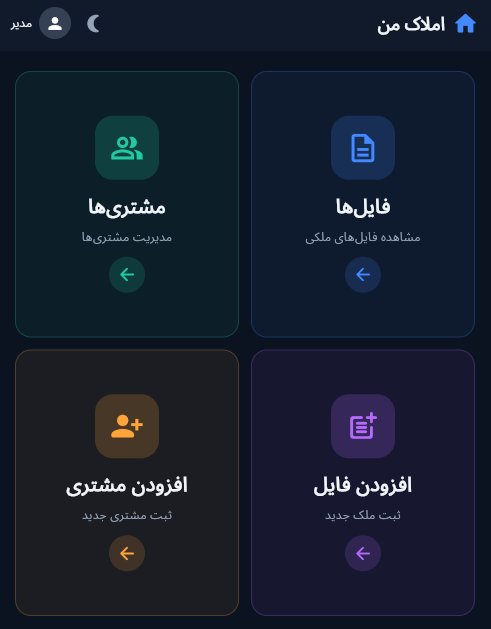
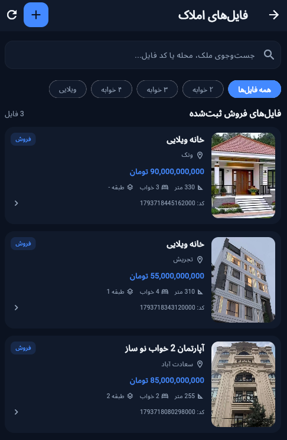
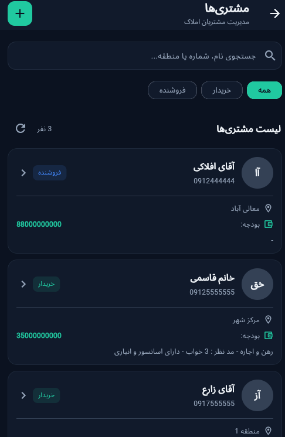

# Estate Management

### A Modern Property & Customer Management Application Built with Flutter

Manage real estate properties and customer information through a clean, responsive web application.

  <a href="https://7c54dbeb.estate-management.pages.dev">
    <strong>🚀 Live Demo</strong>
  </a>

---

## 📸 Screenshots

# Estate Management

### A Modern Property & Customer Management Application Built with Flutter

Manage real estate properties and customer information through a clean, responsive web application.

  <a href="https://7c54dbeb.estate-management.pages.dev">
    <strong>🚀 Live Demo</strong>
  </a>

---

## 📸 Screenshots

<table>
  <tr>
    <td align="center">
      <strong>Dashboard</strong> 
      
    </td>
    <td align="center">
      <strong>Properties</strong> 
      
    </td>
  </tr>
  <tr>
    <td align="center">
      <strong>Customers</strong> 
      
    </td>
    <td align="center">
      <strong>Add Property</strong> 
      
    </td>
  </tr>
  <tr>
    <td align="center" colspan="2">
      <strong>Add Customer</strong> 
      
    </td>
  </tr>
</table>
---

## 📖 About the Project

Estate Management is a web-based application developed with Flutter to simplify the management of real estate properties and customer information.

The project focuses on providing an organized and user-friendly experience while using browser-based storage to keep application data available locally.

It was developed as a practical project to demonstrate Flutter web development, local data persistence, and responsive user interface implementation.

## 🛠 Tech Stack

| Technology | Purpose |
|---|---|
| Flutter | User interface and web application development |
| Dart | Programming language |
| IndexedDB | Browser-based local data storage |
| idb_shim | IndexedDB integration |
| image_picker | Image selection |

## ⚙️ Technical Highlights

- **Flutter Web Development:** Built using Flutter and Dart.
- **Local Data Persistence:** Uses IndexedDB to store application data in the browser.
- **Image Selection:** Supports selecting images using the Image Picker package.
- **Responsive Interface:** Designed to support different screen sizes, including mobile and desktop.
- **Browser-Based Application:** Accessible through a web browser without requiring a traditional desktop installation.

## 👨‍💻 Author

**Pouya Aghaghasemi**

[GitHub Profile](https://github.com/pouya-aghaghasemi)

---

  Developed with ❤️ using Flutter & Dart

---

## 📖 About the Project

Estate Management is a web-based application developed with Flutter to simplify the management of real estate properties and customer information.

The project focuses on providing an organized and user-friendly experience while using browser-based storage to keep application data available locally.

It was developed as a practical project to demonstrate Flutter web development, local data persistence, and responsive user interface implementation.

## 🛠 Tech Stack

| Technology | Purpose |
|---|---|
| Flutter | User interface and web application development |
| Dart | Programming language |
| IndexedDB | Browser-based local data storage |
| idb_shim | IndexedDB integration |
| image_picker | Image selection |

## ⚙️ Technical Highlights

- **Flutter Web Development:** Built using Flutter and Dart.
- **Local Data Persistence:** Uses IndexedDB to store application data in the browser.
- **Image Selection:** Supports selecting images using the Image Picker package.
- **Responsive Interface:** Designed to support different screen sizes, including mobile and desktop.
- **Browser-Based Application:** Accessible through a web browser without requiring a traditional desktop installation.

## 👨‍💻 Author

**Pouya Aghaghasemi**

[GitHub Profile](https://github.com/pouya-aghaghasemi)

---

  Developed with ❤️ using Flutter & Dart

